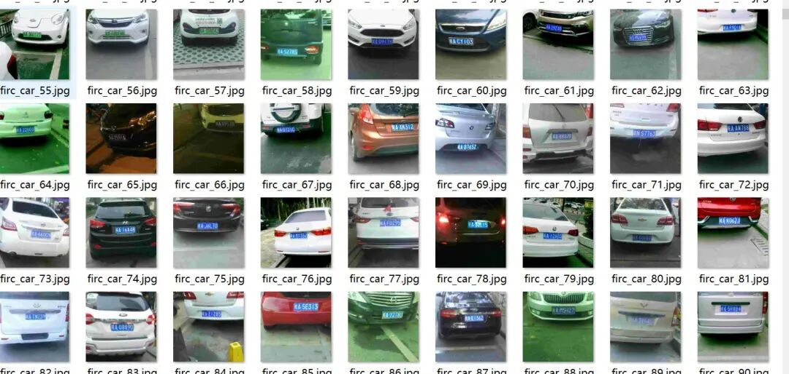
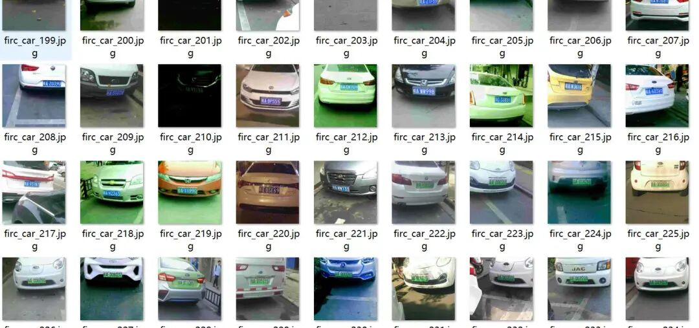
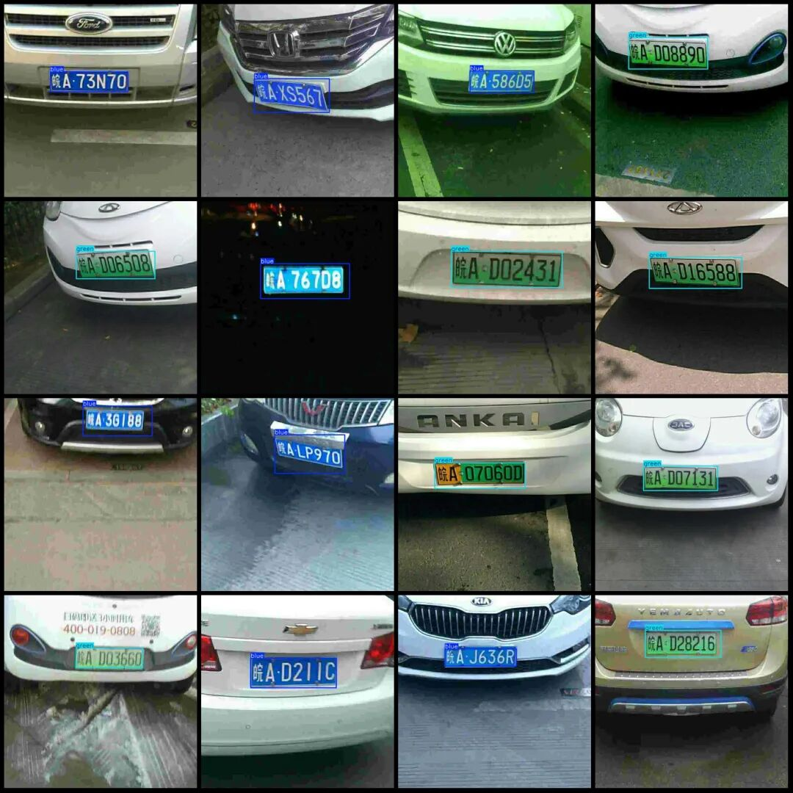
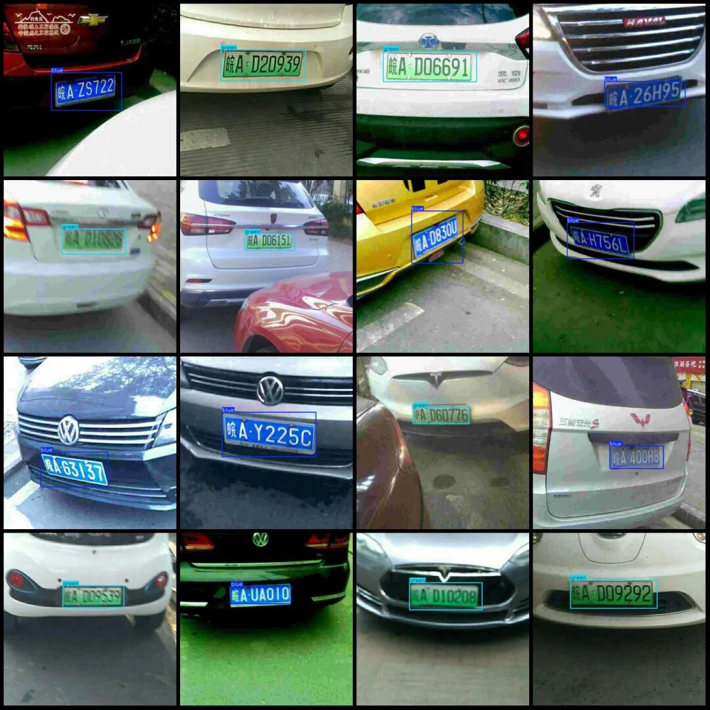

# Dataset for Vehicle Inspection of New Energy Vehicles with Blue and Green License Plates in VOC+YOLO format, 2200 samples, 2 classes

Dataset format: Pascal VOC format + YOLO format (txt file without split path, only containing jpg images and corresponding VOC format xml files and yolo format txt files)

Number of images (number of jpg files): 2198

Number of annotations (number of xml files): 2198

Number of annotations (number of txt files): 2198

Labeling category count: 2

Label category names (Note that the order of categories in the YOLO format does not correspond to this, but is based on the labels folder's classes.txt): ["blue", "green"]

Number of boxes labeled in each category:

Blue Frame Count = 1105

Green frame count = 1101

Total frame count: 2206

Image resolution: 640x640

Using labelImg:

Annotation rules: Draw a rectangle around the category.

Important Notice: The dataset does not have separate training, validation, and test sets; you need to partition them yourself.

Special : This dataset does not guarantee the accuracy of the trained models or weight files.

Image Preview:

Annotation example:

## Payment

Here is a pay link on Stripe ( https://buy.stripe.com/3cs8yP7sY87d0vu9AB ). Please contact me lonlonago@foxmail.com after funding $89, and I will send you a complete data files , thank you!

